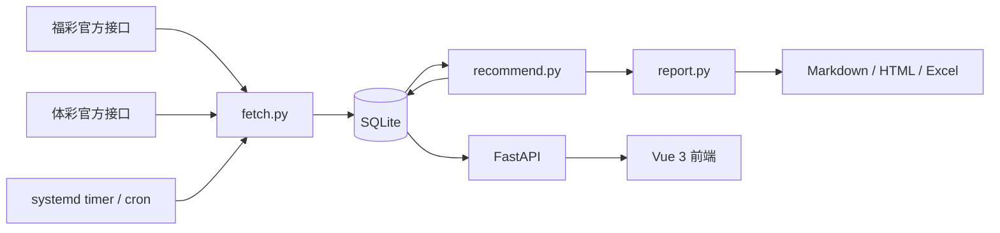

# 彩票数据观察

[GitHub](https://github.com/Andr3Wang/lottery-data-review) · [Gitee](https://gitee.com/Andr3w/lottery-data-review) · [在线页面](http://82.157.181.139:8888)

一个本地优先的彩票历史数据采集、统计分析与**结构化选号**工具。覆盖中国福利彩票和中国体育彩票的 8 个常见玩法，每天从官方公开接口增量抓取开奖数据，保存到 SQLite，生成下一期参考组合，并通过 FastAPI + Vue 提供只读查询页面。

> **重要说明：彩票每期独立开奖，历史数据不能提高任何一注的中奖概率。**
> 本项目不是预测软件，不承诺中奖，也不构成购彩建议。它做的事情是：采集历史数据、做可复现的结构筛选、把结果以透明的方式展示出来。

---

## 1. 项目定位

这个项目解决三个具体问题：

1. **历史数据自动化**：每天抓取最新开奖，增量入库，避免手工整理。
2. **组合筛选可解释**：用固定的特征、约束和评分生成号码，而不是“黑盒预测”。
3. **结果可复现**：同一期、同一 salt 生成同一组结果，方便核对和回测。

项目不做用户系统、不做投注、不接入支付，也不保存任何个人信息。

---

## 2. 覆盖玩法

| 类型 | 玩法 | 数据源 | 规则 |
|---|---|---|---|
| 乐透 | 双色球 | 福彩 | 33 选 6 + 蓝球 16 选 1 |
| 乐透 | 超级大乐透 | 体彩 | 前区 35 选 5 + 后区 12 选 2 |
| 乐透 | 七乐彩 | 福彩 | 30 选 7 |
| 基诺 | 快乐8 | 福彩 | 开奖 20 个号，按选十生成 10 个号 |
| 数字 | 福彩3D | 福彩 | 3 位数字 |
| 数字 | 排列3 | 体彩 | 3 位数字 |
| 数字 | 排列5 | 体彩 | 5 位数字 |
| 数字 | 7星彩 | 体彩 | 6 位 + 后区 0～14 |

未覆盖：竞彩、传统足彩、刮刮乐 / 顶呱刮。它们需要赛事、赔率、球队或即开票数据，属于另一套系统。

---

## 3. 核心：推荐逻辑

### 3.1 先划清边界

推荐结果**不提高单注中奖概率**。原因很简单：在公平独立开奖下，每一注合法组合的理论概率相同。

所以本项目的推荐只优化三件事：

- **结构**：和值、奇偶、大小、分区、连号等形态更均衡；
- **分散**：5 组号码之间不完全重复，避免买成几注高度相似的组合；
- **减少撞号**：双色球、大乐透这类奖池均分玩法，避开生日号、极端连号等大众形态，只可能改善“中奖后分到多少”，不改善“能不能中”。

固定奖金玩法（3D、排列3、排列5、快乐8等）没有“反撞号”收益。

### 3.2 总体流程

```text
读取历史数据
  -> 计算频率、遗漏、和值、分区等特征
  -> 用加权采样生成大量候选组合
  -> 硬约束过滤
  -> 计算结构排序分
  -> 贪心选择 5 组，控制组间重叠
  -> 输出号码 + 可读依据
```

每期每个玩法默认生成 5 组。随机种子为：

```text
sha256(game + target_issue + salt)
```

因此同一期、同一 salt 的结果可复现；换 salt 会得到另一组同样符合规则的号码。

### 3.3 乐透型：双色球 / 大乐透 / 七乐彩

对每个号码计算四类特征：

```text
近 30 期出现频率  32%
近 100 期出现频率 23%
近 300 期出现频率 15%
当前遗漏 / 平均间隔 30%
```

先做 z-score 标准化，再用 softmax 转成抽样权重：

```text
base_i = 0.32*z30_i + 0.23*z100_i + 0.15*z300_i + 0.30*z_omission_i
p_i = exp(base_i / T) / sum(exp(base_j / T))
```

乐透型的 softmax 温度约为 `0.72`。这里的“遗漏回补”只是历史描述指标，**不是独立开奖下的预测信号**。

候选组合还要通过硬约束：

- 和值落在近 300 期的 10%～90% 分位；
- 奇偶比例落在常见区间：
  - 6 码：2:4～4:2
  - 5 码：2:3～3:2
  - 7 码：3:4～4:3
- 大小比例接近均衡；
- 三个分区每区至少 1 个号，单区不过度集中；
- 连号最多 1 对；
- 与上期最多重 1 个号，七乐彩最多 2 个；
- 双色球、大乐透前区至少带 1 个 `>31` 的号，避开全生日号形态；
- 排除同尾、等差数列等明显的人手形态。

最后排序公式：

```text
final = base
        + 0.25 * odd_balance
        + 0.20 * zone_balance
        + 0.20 * sum_fit
        + anti_collision_bonus
        + small_jitter
```

双色球蓝球、大乐透后区单独统计：

```text
extra_score = 0.36*z30 + 0.24*z100 + 0.40*z_omission
```

### 3.4 数字型：3D / 排列3 / 排列5 / 7星彩

按百位、十位、个位（以及第 4～6 位）分别统计：

```text
近 30 期频率      35%
近 100 期频率     25%
遗漏 / 期望间隔   40%
```

每位数字单独做 softmax，再组合成完整号码。硬约束包括：

- 和值落在历史 10%～90% 分位；
- 跨度落在历史 10%～90% 分位；
- 奇偶比例落在常见区间；
- 排除豹子、顺子等形态；
- 5 组之间至少 2 位不同。

7星彩后区（0～14）单独按频率 + 遗漏排序，5 组各配一个不同的后区号。

### 3.5 快乐8（选十）

- 近 30 / 100 / 300 期频率 + 遗漏回补；
- 8 个区（每区 10 个号）至少覆盖 5 个区，单区不超过 3 个号；
- 奇偶 4:6～6:4；
- 和值落在历史 10%～90% 分位；
- 5 组之间最多重叠 4 个号。

### 3.6 组间分散与反撞号

选出候选组合后，使用贪心算法保证：

- 乐透 5 组之间最多重叠 2 个号（七乐彩最多 3 个）；
- 数字型 5 组之间至少 2 位不同；
- 快乐8 5 组之间最多重叠 4 个号。

这样做的目的不是提高单注概率，而是避免 5 注几乎一样，降低“买了 5 注但实际只覆盖 1～2 种结构”的浪费。

### 3.7 推荐分数是什么

代码内部会计算一个排序分，用于给候选组合排序。它**不是中奖概率**，也不是模型置信度，页面和报告默认不展示。真正展示给用户的是号码、期号、日期和可读的结构依据。

---

## 4. 软件方案

### 4.1 总体方案

这是一个单机优先、读多写少的轻量系统：

- **Python 3.12**：抓取、统计、推荐、报告、API；
- **SQLite**：历史开奖、推荐记录、运行记录的单一数据源；
- **FastAPI**：只读查询 API；
- **Vue 3 + Vite**：前端展示；
- **Nginx**：生产环境反向代理和静态资源服务；
- **cron / systemd timer**：Linux 每日定时任务。

单用户、低频写入、主要是读取，因此 SQLite 足够。当前没有用户管理、登录、支付和多租户需求，不需要上 MySQL/PostgreSQL。

### 4.2 数据流

```text
官方公开接口
    |
    v
fetch.py  ---- 增量抓取 / 重试 / 解析
    |
    v
SQLite (data/lottery.db)
    |
    +--> recommend.py ---- 生成 5 组 / 写回 recommendations
    |         |
    |         +--> report.py ---- Markdown / HTML / Excel
    |
    +--> api/main.py ---- 只读 JSON API
              |
              v
           Vue 3 前端
```

### 4.3 每日更新策略

- 每日 22:30 运行一次；
- 福彩每次约 160 期，体彩每次约 200 期；
- 本地不足 500 期时自动全量抓取；
- 按 `(game, issue)` 去重；
- 官方开奖后留 45 分钟发布缓冲；
- 数据未更新时默认重试 3 次，每次间隔 180 秒；
- 重试后仍陈旧：生成报告但返回非零退出码，并在日志中警告；
- 体彩大乐透下一期优先读官方销售期接口；其他玩法按开奖星期 + 休市日历计算；
- 休市日历：2026 年使用官方公告，2027 年暂用待确认的临时日历。

---

## 5. 系统架构



### 组件职责

| 模块 | 职责 |
|---|---|
| `fetch.py` | 官方接口请求、重试、解析、下一期官方日期 |
| `lottery_calendar.py` | 开奖星期、休市日历、下一期期号/日期 |
| `market_holidays.py` | 春节/国庆休市区间 |
| `recommend.py` | 特征计算、候选生成、过滤、排序、组间分散 |
| `recommend_features.py` | 频率、遗漏、和值、分区、熵等基础特征 |
| `db.py` | SQLite schema、迁移、upsert、推荐持久化 |
| `report.py` | Markdown / HTML / Excel 报告 |
| `api/main.py` | 只读 JSON API、静态前端托管 |
| `run_daily.py` | 每日主流程、新鲜度校验、重试、报告生成 |
| `backtest.py` | Walk-forward 回测和随机基线对照 |

---

## 6. 项目结构

```text
Lottery/
├── api/
│   └── main.py                 # FastAPI 只读 API
├── data/                       # SQLite 本地数据（不提交）
├── logs/                       # 运行日志（不提交）
├── reports/                    # 生成报告（不提交）
├── deploy/                     # systemd / Nginx 部署配置
├── tests/
│   ├── test_core.py
│   └── test_backtest.py
├── web/                        # Vue 3 + Vite 前端
├── backtest.py
├── config.py                   # 玩法、概率、开奖时间配置
├── db.py
├── fetch.py
├── lottery_calendar.py
├── market_holidays.py
├── models.py
├── recommend.py
├── recommend_features.py
├── report.py
├── run_daily.py
├── run_daily.bat               # Windows 手动运行
├── run_daily.pyw               # Windows 计划任务入口
├── requirements.txt
├── .gitignore
└── README.md
```

---

## 7. 数据模型

SQLite 主要有三张表：

### `draws`

```text
game, issue, draw_date, numbers, extra, sales, pool, raw
PRIMARY KEY (game, issue)
```

### `recommendations`

```text
run_id, game, target_issue, rank,
numbers, extra, score, rationale,
target_date, target_date_source, created_at
```

### `runs`

```text
run_id, created_at, summary
```

`data/lottery.db` 是本地数据文件，不应提交到 Git。首次运行 `run_daily.py` 会自动建库并抓取历史数据。

---

## 8. 快速开始

### 环境

- Python 3.10+，推荐 3.12
- Node.js 20+
- Windows / Linux 均可

### 安装后端

```bash
python -m venv .venv
# Windows
.venv/Scripts/activate
# Linux
source .venv/bin/activate

pip install -r requirements.txt
```

### 首次抓取并生成报告

```bash
python run_daily.py
```

会生成：

```text
data/lottery.db
reports/latest.md
reports/latest.html
reports/latest.xlsx
```

### 启动 API

```bash
python -m uvicorn api.main:app --host 127.0.0.1 --port 8000
```

如果 `web/dist` 已构建，FastAPI 会直接托管前端：

```text
http://127.0.0.1:8000/
```

API 文档：

```text
http://127.0.0.1:8000/docs
```

### 构建前端

```bash
cd web
npm ci
npm run build
```

前端开发模式：

```bash
cd web
npm run dev
```

---

## 9. 自动运行

### Windows 计划任务

```powershell
schtasks /Create /SC DAILY /TN "CodexLotteryDaily" /TR ""pythonw.exe" "D:\Workspace\Project\Lottery
un_daily.pyw"" /ST 22:30 /F
```

注意：Windows 计划任务默认只在用户登录时运行；机器关机、休眠或未登录时不会自动补跑。

### Linux systemd

建议生产环境使用 `systemd timer`，不要在 Nginx 或 API 进程里跑抓取。仓库的 `deploy/` 目录已提供可直接复制的 service、timer 和 Nginx 配置。

`/etc/systemd/system/lottery-daily.service`：

```ini
[Unit]
Description=Lottery daily fetch and recommendation
After=network-online.target

[Service]
Type=oneshot
WorkingDirectory=/opt/lottery
Environment=PYTHONIOENCODING=utf-8
ExecStart=/opt/lottery/.venv/bin/python /opt/lottery/run_daily.py
```

`/etc/systemd/system/lottery-daily.timer`：

```ini
[Unit]
Description=Run lottery daily job at 22:30 Asia/Shanghai

[Timer]
OnCalendar=*-*-* 22:30:00 Asia/Shanghai
Persistent=true

[Install]
WantedBy=timers.target
```

启用：

```bash
sudo systemctl daemon-reload
sudo systemctl enable --now lottery-daily.timer
```

---

## 10. API

| 方法 | 路径 | 说明 |
|---|---|---|
| GET | `/api/health` | 健康检查 |
| GET | `/api/games` | 玩法列表和最新期信息 |
| GET | `/api/latest` | 各玩法最新开奖 |
| GET | `/api/draws?game=ssq&limit=50` | 历史开奖分页 |
| GET | `/api/recommendations?game=ssq` | 最新推荐组合 |
| GET | `/api/stats/{game}` | 频率、和值、奇偶、跨度统计 |
| GET | `/api/probability` | 各玩法理论概率说明 |

API 只读，不提供写接口；每日更新由 `run_daily.py` 完成。

---

## 11. 回测与验证

回测文件：

```bash
python backtest.py
```

方法：

- Walk-forward：每期只用该期之前的数据；
- 策略生成 5 注；
- 随机基线也生成 5 注，重复多次取平均；
- 比较命中率、头奖命中、高命中代理指标；
- 使用 bootstrap 置信区间和置换检验。

当前回测结论：**没有发现任何玩法显著优于随机基线**。这符合独立开奖的理论预期。回测在这里的作用是验伪，不是证明可以盈利。

---

## 12. 设计取舍

1. **为什么不直接做“预测模型”**
   公平独立开奖下，历史数据没有可利用的未来信号。把频率、遗漏、和值包装成“AI预测”只会制造错误预期。

2. **为什么保留频率和遗漏**
   它们用于描述历史、构造候选和生成可读依据，不用于声称预测能力。

3. **为什么用 SQLite**
   单机、单写者、低频写入、读多写少，SQLite 足够，部署和备份都简单。

4. **为什么保留 5 组**
   多注是线性叠加概率，不能提高单注概率；组间分散主要减少重复覆盖，并让结果更易读。

5. **为什么反撞号只对部分玩法有意义**
   只有奖池均分的一等奖才存在“中奖后和别人分奖金”的问题；固定奖金玩法没有这项收益。

---

## 13. 部署到 GitHub 前

仓库已经通过 `.gitignore` 排除：

- `data/*.db`
- `reports/*`
- `logs/*`
- `web/node_modules/`
- `web/dist/`
- `__pycache__/`
- `.env` / secrets

首次推送：

```bash
git init
git add .
git commit -m "Initial commit"
git branch -M main
git remote add origin git@github.com:<your-name>/<repo>.git
git push -u origin main
```

不要把服务器密码、API Key、SSH 私钥、数据库文件或日志提交到 GitHub。

### Nginx 生产部署示意

```nginx
server {
    listen 80;
    server_name _;

    root /opt/lottery/web/dist;
    index index.html;

    location /api/ {
        proxy_pass http://127.0.0.1:8000;
        proxy_set_header Host $host;
        proxy_set_header X-Real-IP $remote_addr;
    }

    location / {
        try_files $uri /index.html;
    }
}
```

FastAPI 只监听 `127.0.0.1:8000`，由 Nginx 对外提供 80/443。

---

## 14. 已知限制

- 2027 年彩票市场休市公告尚未发布，当前 2027 日历是临时日历，代码中明确标记为 `provisional`。
- 福彩部分历史接口从 2013 年左右开始，不是所有玩法都覆盖完整历史；最近 300 期模型不受影响。
- 官方接口可能改版、限流或返回异常数据，抓取层有重试，但仍需要关注日志。
- 回测样本有限，且头奖极其稀缺；任何“回测看起来更好”的结果都要优先怀疑过拟合。
- 本项目的推荐分数是内部排序分，不是中奖概率，不在页面上展示。

---

## 15. 风险提示

- 中国内地禁止向未成年人销售彩票，未成年人不得购彩、兑奖。
- 彩票是负期望的娱乐消费，不是投资。
- 请设定固定预算，不要借贷、不要追号、不要相信“内部号”“必中软件”“AI预测”。
- 本项目仅供学习、统计和娱乐参考，不构成任何购彩建议。
